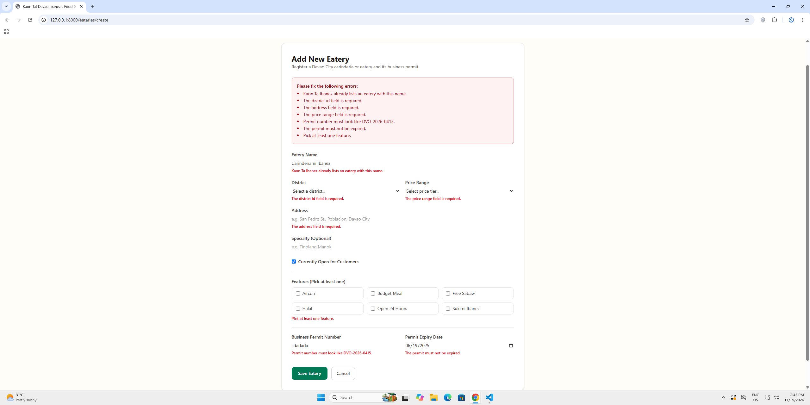

# Kaon Ta! Davao — Ibanez's Food Guide

**Student Name:** [Firstname] Ibanez  
**Course:** 4-334 CS Elective 2 — Full-Stack Development (Laravel)  
**Repository:** `PrefinalProject-Ibanez-KaonTaDavao`

---

## Setup Instructions

Run the following commands on a fresh clone to set up and start the application[cite: 6, 7]:

```bash
composer install
cp .env.example .env
php artisan key:generate
touch database/database.sqlite
php artisan migrate:fresh --seed
npm install
npm run build
php artisan serve
# or npm run dev while developing
```

---

## Personalized Seed Data

- **Districts (6):** Poblacion, Talomo, Agdao, Buhangin, Toril, Calinan *(update if you chose a different 6th allowed district)*[cite: 6]
- **Features (6):** Suki ni Ibanez, Budget Meal, Halal, Open 24 Hours, Aircon, Dine-In *(update if you chose a different 6th feature)*[cite: 6]
- **Seeded Users (2):**
  - `[Firstname] Ibanez` (`ibanez@kaonta.test`)[cite: 2, 6]
  - `Tita Ibanez` (`tita.ibanez@kaonta.test`)[cite: 2, 6]
- **Hand-Made Eatery:**
  - **Name:** `Carinderia ni Ibanez`[cite: 2, 6]
  - **Slug:** `carinderia-ni-ibanez`[cite: 2, 6]
  - **District:** `Poblacion`[cite: 6]
  - **Address:** `San Pedro St., Poblacion, Davao City`[cite: 6]
  - **Price Range:** `budget`[cite: 6]
  - **Specialty:** `Tinolang Manok`[cite: 6]
  - **Features:** `Suki ni Ibanez`, `Budget Meal`[cite: 6]
  - **Permit Number & Expiry:** `DVO-2026-0415` (expiring `2027-04-15`) *(update `0415` to your actual birthday MMDD)*[cite: 2, 6]

---

## Eloquent Relationships

| Relationship | Type | Why This Relationship Fits |
| :--- | :--- | :--- |
| `District` $\leftrightarrow$ `Eatery` | `hasMany` / `belongsTo`[cite: 2] | One Davao district can contain many eateries, while each eatery is located in a single district. |
| `Eatery` $\leftrightarrow$ `Dish` | `hasMany` / `belongsTo`[cite: 3] | An eatery offers multiple dishes on its menu, and each dish belongs to one specific eatery. |
| `Eatery` $\leftrightarrow$ `Review` | `hasMany` / `belongsTo`[cite: 3] | Residents can post many reviews for an eatery, while each review is written about one eatery. |
| `User` $\leftrightarrow$ `Review` | `hasMany` / `belongsTo`[cite: 3] | One reviewer can write multiple reviews across different eateries, and each review has one author. |
| `Eatery` $\leftrightarrow$ `Permit` | `hasOne` / `belongsTo`[cite: 3] | Each eatery is issued exactly one official city business permit, and that permit belongs to one eatery. |
| `Eatery` $\leftrightarrow$ `Feature` | `belongsToMany` (`eatery_feature`)[cite: 3] | An eatery can have several tags like Halal or Aircon, and each feature tag applies to many eateries. |
| `District` $\rightarrow$ `Review` | `hasManyThrough` (via `Eatery`)[cite: 3] | A district collects reviews indirectly through all the eateries situated within that district. |

---

## Route List (`php artisan route:list --except-vendor`)

```text
  GET|HEAD        / ................................................................................................................................................................................................... home › HomeController
  GET|HEAD        districts ...................................................................................................................................................................... districts.index › DistrictController@index
  GET|HEAD        districts/{district} ............................................................................................................................................................. districts.show › DistrictController@show
  GET|HEAD        eateries .......................................................................................................................................................................... eateries.index › EateryController@index
  POST            eateries .......................................................................................................................................................................... eateries.store › EateryController@store
  GET|HEAD        eateries/create ................................................................................................................................................................. eateries.create › EateryController@create
  GET|HEAD        eateries/{eatery} ................................................................................................................................................................... eateries.show › EateryController@show
  PUT|PATCH       eateries/{eatery} ............................................................................................................................................................... eateries.update › EateryController@update
  DELETE          eateries/{eatery} ............................................................................................................................................................. eateries.destroy › EateryController@destroy
  GET|HEAD        eateries/{eatery}/edit .............................................................................................................................................................. eateries.edit › EateryController@edit
  POST            eateries/{eatery}/reviews ................................................................................................................................................. eateries.reviews.store › ReviewController@store
  GET|HEAD        reviewers/{user} ................................................................................................................................................................. reviewers.show › ReviewerController@show
  DELETE          reviews/{review} ............................................................................................................................................................... reviews.destroy › ReviewController@destroy
```

---

## Screenshots

### 1. Eatery List (`/eateries`)


### 2. Eatery Detail Page with Reviews (`/eateries/carinderia-ni-ibanez`)


### 3. Create Eatery Form Showing Validation Errors (`/eateries/create`)
