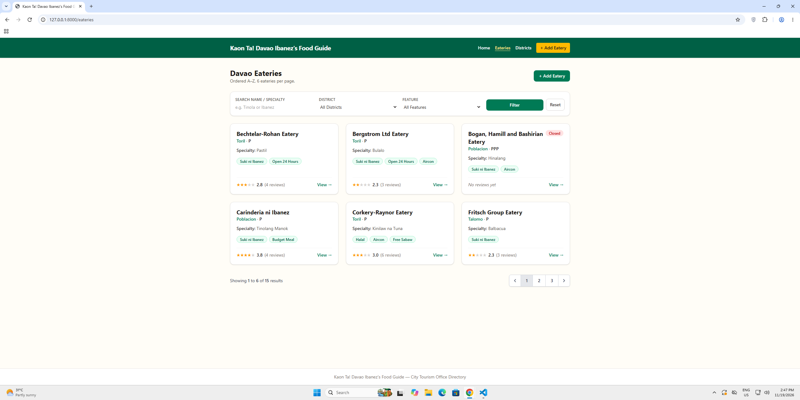
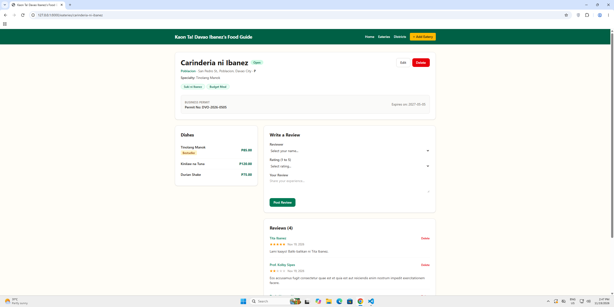

# Kaon Ta! Davao — Ibanez's Food Guide

**Name:** Luis Ibanez
**Course:** 4-334 CS Elective 2 — Full-Stack Development (Laravel)
**Repository:** `PrefinalProject-Ibanez-KaonTaDavao`

## Setup Commands

Run these commands after cloning the repository to set up and run the app:

```bash
composer install
cp .env.example .env
php artisan key:generate
touch database/database.sqlite
php artisan migrate:fresh --seed
npm install
npm run build
php artisan serve
# or npm run dev while developing
```

## Personalized Data

- **Districts (6):** Poblacion, Talomo, Agdao, Buhangin, Toril, Calinan
- **Features (6):** Suki ni Ibanez, Budget Meal, Halal, Open 24 Hours, Aircon, Dine-In
- **Seeded Users (2):**
  - `Ibanez` (`ibanez@kaonta.test`)
  - `Tita Ibanez` (`tita.ibanez@kaonta.test`)
- **Hand-Made Eatery:**
  - **Name:** `Carinderia ni Ibanez`
  - **Slug:** `carinderia-ni-ibanez`
  - **District:** `Poblacion`
  - **Address:** `San Pedro St., Poblacion, Davao City`
  - **Price Range:** `budget`
  - **Specialty:** `Tinolang Manok`
  - **Features:** `Suki ni Ibanez`, `Budget Meal`
  - **Permit Number & Expiry:** `DVO-2026-0505` (expires `2027-05-05`)

## Relationships

| Relationship | Type | Why This Relationship Fits |
| :--- | :--- | :--- |
| District & Eatery | `hasMany` / `belongsTo` | One district in Davao can have many eateries, and each eatery belongs to one district. |
| Eatery & Dish | `hasMany` / `belongsTo` | One eatery serves many dishes on its menu, and each dish belongs to one eatery. |
| Eatery & Review | `hasMany` / `belongsTo` | One eatery can receive many reviews from customers, and each review is for one eatery. |
| User & Review | `hasMany` / `belongsTo` | One user can write many reviews for different eateries, and each review is written by one user. |
| Eatery & Permit | `hasOne` / `belongsTo` | One eatery only has one official business permit, and that permit belongs to that single eatery. |
| Eatery & Feature | `belongsToMany` (`eatery_feature`) | One eatery can have multiple features like Halal or Aircon, and each feature can belong to many eateries. |
| District & Review | `hasManyThrough` (via `Eatery`) | A district gathers all reviews indirectly through the eateries located inside that district. |

## Route List (`php artisan route:list --except-vendor`)

```text
  GET|HEAD   / .................................................. home › HomeController
  GET|HEAD   districts ......................... districts.index › DistrictController@index
  GET|HEAD   districts/{district} ................ districts.show › DistrictController@show
  GET|HEAD   eateries ............................ eateries.index › EateryController@index
  POST       eateries ............................ eateries.store › EateryController@store
  GET|HEAD   eateries/create ................... eateries.create › EateryController@create
  GET|HEAD   eateries/{eatery} ..................... eateries.show › EateryController@show
  PUT|PATCH  eateries/{eatery} ................. eateries.update › EateryController@update
  DELETE     eateries/{eatery} ............... eateries.destroy › EateryController@destroy
  GET|HEAD   eateries/{eatery}/edit ................ eateries.edit › EateryController@edit
  POST       eateries/{eatery}/reviews . eateries.reviews.store › ReviewController@store
  GET|HEAD   reviewers/{user} .................... reviewers.show › ReviewerController@show
  DELETE     reviews/{review} ................ reviews.destroy › ReviewController@destroy
```

## Screenshots

### 1. Eatery List (`/eateries`)


### 2. Eatery Page with Reviews (`/eateries/carinderia-ni-ibanez`)


### 3. Create Form with Validation Errors (`/eateries/create`)
